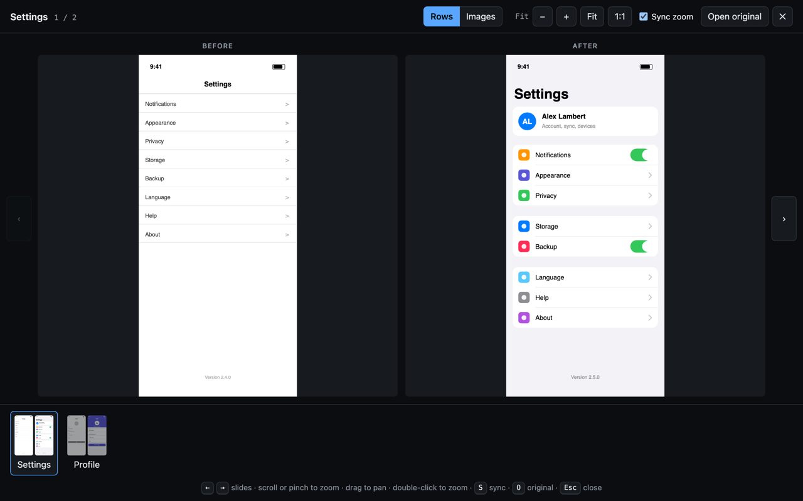
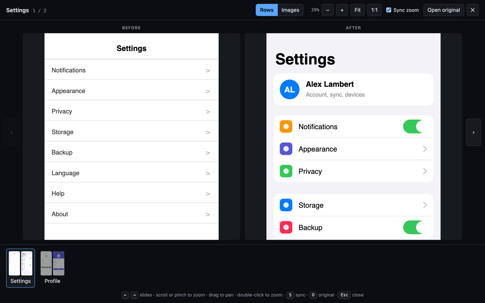
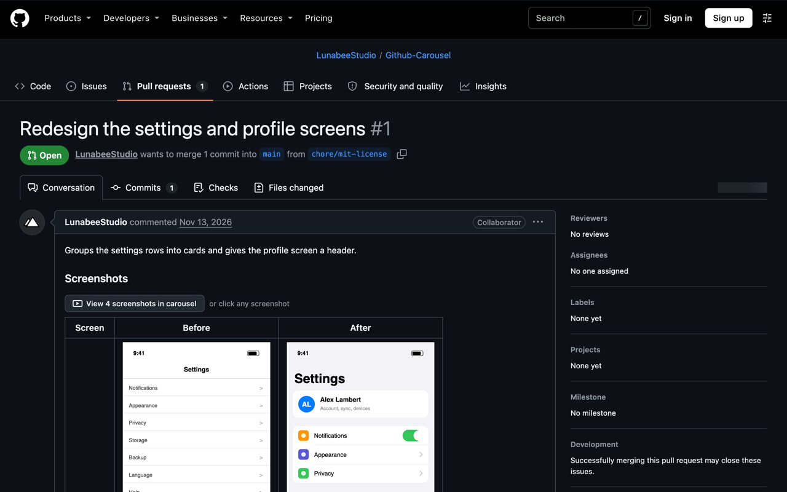

# GitHub Carousel

Chrome extension that turns screenshot tables in GitHub pull requests into a full-screen carousel with zoom, so UI changes are faster to review.

It finds every table in a PR description or comment that holds images, adds a **View N screenshots in carousel** button above it, and opens the carousel when you click the button or any screenshot in the table.



| Sync zoom | Trigger button on the PR |
| --- | --- |
|  |  |

## Install

There is no store release yet. Load it unpacked:

1. Clone this repository.
2. Open `chrome://extensions` and turn on **Developer mode**.
3. Click **Load unpacked** and pick the repository folder.

After pulling changes, click the reload icon on the extension card, then refresh the PR tab.

## Features

- **Slides follow the table.** One table row per slide shows Before and After side by side, captioned with the column headers. One image per slide is the other option. Rows with more than 4 images always open one image at a time.
- **Captions** come from the column header, or from the text in the image's cell (for example a `<sub>` under the image) when the table has no header row.
- **Zoom:** scroll or pinch at the pointer, drag to pan, double-click to zoom in or back to fit. **1:1** shows real image pixels.
- **Sync zoom** moves every column together, so the same detail lines up in Before and After.
- **Open original** opens the current image in a new tab. Cmd-click or Ctrl-click on a screenshot still opens the raw file directly.
- **Full-size images:** the carousel loads the original upload, not the small version shown in the table.
- Works after GitHub's in-page navigation, on comments loaded later, and in light and dark themes.

## Keyboard

| Key | Action |
| --- | --- |
| `←` `→` | Previous or next slide |
| `+` `-` | Zoom in or out |
| `0` | Fit |
| `1` | Real image pixels |
| `S` | Sync zoom on or off |
| `O` | Open original |
| `Esc` | Close |

GitHub shortcuts are blocked while the carousel is open.

## Settings

Slide unit, sync zoom and "keep zoom when changing slide" are saved with Chrome sync storage. Change them in the carousel toolbar or on the extension's options page (right-click the extension icon, then **Options**).

## Permissions

Only `storage`, for the settings. The extension runs on `github.com` pages and sends no data anywhere. See the [privacy policy](PRIVACY.md).

## Development

Plain JavaScript and CSS, no build step and no dependencies. See [CLAUDE.md](CLAUDE.md) for the architecture and the GitHub page quirks the code handles.

```sh
for f in src/*.js options/options.js; do node --check "$f"; done
```

Build the Chrome Web Store upload (`dist/github-carousel-<version>.zip`):

```sh
./scripts/package.sh
```

## Credits

Icon: [Carrousel](https://www.flaticon.com/fr/icone-gratuite/carrousel_2731218) by [AmethystDesign](https://www.flaticon.com/fr/auteurs/amethystdesign) on [Flaticon](https://www.flaticon.com/).

## License

[MIT](LICENSE)
